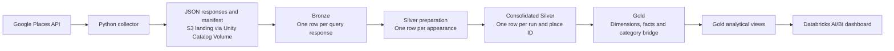

# Places Ratings — Business Discovery Lakehouse

A personal Data Engineering project that turns Google Places API responses into a business explorer for selected commercial areas of La Paz and El Alto, Bolivia.

**Python ingestion → Amazon S3 landing → Spark SQL / Delta Lake → dimensional Gold model → Databricks AI/BI dashboard.**

The business motivation is to investigate segments for a possible NFC review-capture service. This repository implements the data foundation and exploratory analysis; it does not implement the NFC product or establish willingness to pay.

## Current result

| Validated baseline | Result |
|---|---:|
| Extraction | `baseline_001`, collected November 9, 2026 |
| Planned discovery queries / saved responses | 315 / 315 |
| Business appearances across responses | 3,272 |
| Distinct establishments / consolidated snapshots | 1,314 |
| Establishments with a reported review count greater than zero | 1,011 |
| Establishments with an unreported review count | 303 |
| Gold dimensions / fact tables / bridges | 6 / 1 / 1 |
| Dashboard pages | 3 |

Figures above come from executed outputs reviewed during project development. The repository includes code and dashboard configuration, not the underlying response files. The dashboard was published in the author's Databricks workspace; access to that workspace is required to view it there.

## Business question

Are cafés and restaurants the strongest segments to explore for a service that helps businesses collect Google reviews?

The analysis separates three questions:

1. **Presence:** what percentage of sampled establishments has at least one reported review?
2. **Volume:** how many reviews do establishments have, using medians and distributions alongside means?
3. **Observed prospect pool:** how many establishments meet explicit exploratory criteria?

The findings changed the initial assumption. Bars and pubs lead the main-category comparison in reported review coverage (83.52%) and median review count (14.5). Restaurants provide the largest observed pool: 481 establishments with reviews. Restaurants and cafés together account for 694 of the 1,011 establishments with reviews in this sample. This supports further commercial investigation, not a claim of validated NFC demand.

## Architecture

S3 is used for landing. Bronze, Silver and Gold are managed Delta tables in Databricks. An independent backup of landing is still pending; managed tables are not described as an S3-independent raw-data backup.

## Engineering decisions

- **Resumable ingestion:** query identities and a frozen run manifest track completed requests. Each successful response is persisted and read back before advancing. This is not a claim of exactly-once external API calls.
- **Explicit grains:** API responses, business appearances and consolidated establishments are different entities. Query overlap must not give repeatedly detected establishments extra statistical weight.
- **Deterministic consolidation:** select the latest whole observation per `(run_id, place_id)` with stable tie-breakers, preserving retrieval memberships as arrays.
- **Idempotent Delta loads:** MERGE keys prevent duplicate inserts on reruns. Content checks detect unexpected changes to previously loaded snapshots.
- **SQL transformations:** parsing, expansion, windows, joins and aggregation use Spark SQL. Python handles API ingestion; this implementation does not depend on PySpark DataFrame transformations.
- **Missing-data semantics:** NULL, explicit zero and explicit false remain distinct. `with_reviews` means `review_count > 0`, not favorable sentiment or a rating threshold.
- **Dimensional modeling:** a snapshot fact preserves capture metrics; SCD1 business descriptions, an SCD0 calendar and a category bridge support analysis without returning to Silver.

## Repository guide

| Location | Purpose |
|---|---|
| [Scope](docs/scope.md) | Business question, sampling and exclusions |
| [Execution guide](docs/runbook.md) | Prerequisites, execution order, reruns and future runs |
| [Data dictionary](docs/data_dictionary.md) | Grains, identities, metrics and denominators |
| [Gold model](docs/gold_model.md) | Dimensions, fact, bridge and historical behavior |
| [Baseline findings](docs/baseline_results.md) | Final main-category results and interpretation |
| [Dashboard guide](docs/dashboard.md) | Import, filters, validation and access |
| [Review and remaining work](docs/project_review.md) | Review evidence and prioritized follow-up |
| [Portfolio case study](portfolio/places_ratings_case_study.md) | Project presentation for GitHub |
| `config/places_baseline.json` | Current baseline definition |
| `src/ingestion/` | API access, planning, persistence and resume logic |
| `notebooks/ingestion/02c_places_baseline.py` | Current collector entry point |
| `notebooks/bronze/03_places_bronze_clean.py` | Persist original responses in Bronze |
| `notebooks/silver/04_places_silver.py` | Parse responses and create temporary observation views |
| `notebooks/silver/EDA/05_places_eda.py` | Observation- and business-level EDA |
| `notebooks/silver/06_places_silver_load.py` | Persist consolidated business snapshots |
| `notebooks/gold/07_places_gold.py` | Build and load Gold; publish analytical views |
| [Dashboard export](Dashboards/Places%20Ratings.lvdash.json) | Importable three-page dashboard definition |

The exploration notebooks, `02_places_api_ingestion.py` and `02b_place_details_enrichment.py` document earlier iterations. They are not additional mandatory extraction steps for the current full-context baseline. Do not run every notebook indiscriminately.

## Run it

This is a Databricks project, not a standalone Python application. See the [execution guide](docs/runbook.md) for storage access, secret configuration and the exact order.

For an existing verified landing baseline, run Bronze, then `06_places_silver_load` (which executes Silver preparation), then Gold. Import the dashboard export afterwards. Existing verified tables can be explored without making new API requests.

## Limitations and next steps

- The discovery design is a purposive sample, not a census. Nearby Search can return at most 20 places per request; overlapping searches do not guarantee exhaustive coverage. [API documentation](https://developers.google.com/maps/documentation/places/web-service/nearby-search).
- Study area is attributed from detected search nuclei, not verified administrative boundaries. Calacoto uses three nuclei; raw zone counts are not directly comparable market-size estimates.
- A single baseline cannot demonstrate growth or the causal impact of NFC.
- Price is reported for only 404 businesses; 62 businesses remain unclassified by the initial primary-type mapping.
- Live API calls are disabled in notebook source. Credentials belong in Databricks Secrets; source-response files are not included in Git.
- **Pending:** orchestration, an independent landing backup, run parameterization before a second extraction, and live revalidation after any dashboard replacement.

## Stack

Databricks Free Edition · Python · Google Places API (New) · Amazon S3 · Unity Catalog · Spark SQL · Delta Lake · Git/GitHub · Databricks AI/BI Dashboards.
