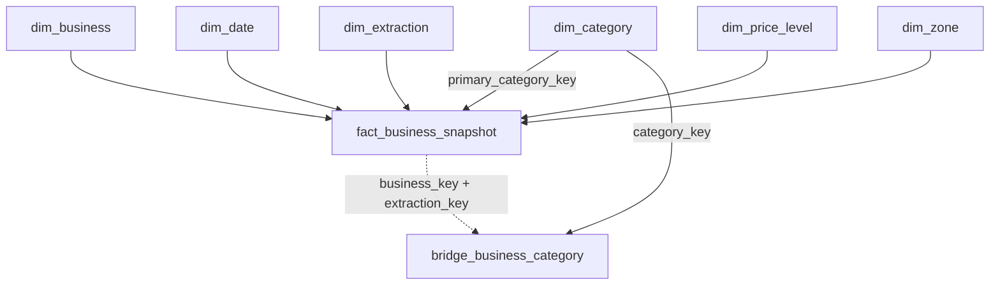

# Modelo Gold — Places Ratings

## Ejecución

Importar `notebooks/gold/07_places_gold.py` como notebook en Databricks y ejecutar de arriba abajo.
La única fuente es `places_ratings.silver.business_snapshots`, ya persistida. No se llama a Google
ni se relee S3. Las tablas nuevas son Delta administradas en `places_ratings.gold`.

## Relaciones

El puente también referencia las claves de negocio y extracción de sus respectivas dimensiones.
Las relaciones se validan mediante consultas; no se declaran restricciones PK/FK que el motor
deba hacer cumplir.

| Tabla | Granularidad y campos principales |
|---|---|
| `dim_business` | Un negocio: business_key, place_id, business_name, name_language, primary_type, formatted_address, latitude, longitude, fecha/run de la descripción |
| `dim_category` | Una categoría: category_key (código estable), category_name, display_order |
| `dim_extraction` | Una extracción: extraction_key, run_id, started_at_utc, finished_at_utc, versiones y conteos de fuente |
| `dim_date` | Un día UTC: date_key YYYYMMDD, fecha, año, trimestre, mes, día del mes, día ISO de semana, fin de semana |
| `dim_price_level` | Un rango: price_level_key, source_price_level, price_level_name, price_order |
| `dim_zone` | Una zona: zone_key, zone_name, city_name |
| `fact_business_snapshot` | Un negocio/extracción: seis claves dimensionales, puntuación, valoraciones, estado, contactos, horarios, enlaces, indicadores de información reportada y trazabilidad |
| `bridge_business_category` | Un negocio/extracción/categoría detectada: business_key, extraction_key, category_key |

SHA-256 genera las claves internas de negocio y extracción. Categorías, zonas y precios usan
códigos estables como claves; no necesitan números consecutivos. La fecha usa un entero YYYYMMDD.

## Clasificación inicial

La categoría principal se calcula con `primary_type`. El CASE completo queda visible en el notebook.
Los tipos específicos de restaurantes terminados en `_restaurant` pertenecen a restaurantes;
los tipos explícitos de cafés, bares, peluquerías, gimnasios y mascotas tienen sus propios grupos.
Los tipos ambiguos, por ejemplo `store`, `beauty_salon`, `medical_clinic` y valores ausentes,
quedan en **Por clasificar**. El puente conserva las categorías de búsqueda sin reinterpretarlas.
Una categoría principal no necesariamente coincide con alguna categoría detectada.

La zona se atribuye a los núcleos donde se detectó el negocio: Sopocachi → Sopocachi;
El Bosque, San Miguel y Montenegro → Calacoto; Tinku → Ciudad Satélite.
Si hay detecciones desde varias zonas, se elige el núcleo detectado más cercano a las coordenadas
del negocio, usando distancia de gran círculo y código de núcleo como desempate estable.
Es una asignación de zona de estudio por origen de búsqueda, no pertenencia administrativa verificada.
La falta de coordenadas o un núcleo desconocido detienen la carga para revisión: no se asigna
silenciosamente una zona incorrecta ni se usa “Sin determinar”. Un miembro antiguo sin determinar
puede permanecer en la dimensión si ya estaba creado, pero la nueva regla no lo usa.

El calendario comprende del 1 de enero de 2026 al 31 de diciembre de 2031 y su carga es solo
de inserción (SCD0), conforme a la decisión de mantener inmutables las fechas existentes.

## Historia e idempotencia

`dim_business` aplica SCD1: nombre, dirección y coordenadas muestran la descripción más reciente.
La tabla de hechos conserva puntuación, conteo, estado, precio, web, teléfono y horarios de cada captura.
Una extracción futura crea nuevas filas de hechos. Repetir la misma carga no agrega filas.
El hash de contenido bloquea cambios silenciosos sobre hechos ya cargados.
Cambiar las reglas de clasificación exige revisar y reconstruir Gold de forma deliberada;
el notebook no borra automáticamente datos. Se incluye una migración explícita y acotada de
`address_zone_v1` a `detected_nucleus_zone_v1`: actualiza zona, versión y hash solo si la fuente
Silver y la versión de clasificación no cambiaron. No sustituye otras métricas históricas.

## Vistas para análisis

- `v_business_explorer`: una fila por negocio/extracción, con dimensiones y métricas.
- `v_business_category_memberships`: una fila por categoría detectada; puede repetir negocios.
- `v_category_metrics`: presencia de al menos una valoración reportada, ceros explícitos y datos ausentes;
  medianas, medias y cobertura por categoría principal y extracción. También incluye cantidades
  con al menos 10 y 50 valoraciones (umbrales exploratorios) y participación de cada categoría
  en el total de negocios con al menos una valoración reportada de esa extracción.
- `v_price_reputation`: reputación por categoría principal y rango de precio, incluidos valores desconocidos.

Las vistas permanentes leen exclusivamente Gold. Los conteos por categoría principal se pueden sumar
por extracción; los de categorías detectadas se superponen. La media de puntuación es una media
entre negocios, no una reconstrucción de la puntuación de todas las reseñas individuales.
El precio es ordinal y no representa montos. NULL no equivale a cero. No se suman los conteos
acumulados de valoraciones de un negocio entre fechas.

Para evaluar la hipótesis usamos tres perspectivas complementarias: presencia (porcentaje de
negocios con al menos una valoración reportada sobre todos los de su categoría), volumen (mediana y distribución
de los conteos reportados) y tamaño del conjunto observado (cantidad de negocios con al menos una valoración
reportada o que cumplen umbrales explícitos). El porcentaje con al menos una valoración entre quienes reportan conteo
usa otro denominador: puede ser 100 % si no hay ceros explícitos, aunque haya muchos datos ausentes.
La participación en el total de negocios con al menos una valoración reportada describe nuestra muestra; no es cuota de mercado
ni evidencia de intención de compra de NFC. Los valores ausentes no prueban ausencia de valoraciones.

## Validación

El notebook incluye controles de identidad, granularidad, rangos, claves dimensionales,
reconciliación de contenido y membresías. Para baseline_001 se esperan 1.314 hechos y
3.272 apariciones de fuente representadas. El número del puente se deriva de Silver.
La validación local es estructural y relacional; la ejecución real de Spark SQL se completa en Databricks.

Referencias de sintaxis: [MERGE INTO](https://docs.databricks.com/aws/en/sql/language-manual/delta-merge-into)
y [explode](https://docs.databricks.com/aws/en/sql/language-manual/functions/explode).
